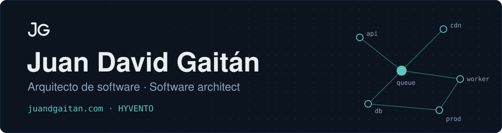

<h1>Juan David Gaitán</h1>

Arquitecto de software · Cofundador de HYVENTO · Pereira, Colombia Software architect · Co-founder of HYVENTO · Pereira, Colombia

&nbsp;

 

 &nbsp;·&nbsp; 

<h2 id="español">Español</h2>

### Sobre mí

Soy Juan David Gaitán, arquitecto de software en Pereira, Colombia.

**Cofundador de HYVENTO.** Dirijo [HYVENTO](https://juandgaitan.com/), un estudio de desarrollo de software para LLCs de EE. UU. y proyectos B2B en Colombia.

**Del frontend a la infraestructura.** Cubro el sistema completo y tomo las decisiones de arquitectura: monolito o microservicios, serverless o servidor dedicado, llamadas síncronas o mensajería.

**Respondo por lo que diseño.** Diseño sistemas de software y respondo por ellos en producción.

**Primer lugar en TINKU Hackathon 2026.** Con mi equipo construimos Solara para Techos Rentables en 18 horas: monitoreo unificado de más de 200 proyectos solares en un solo dashboard. Fui el desarrollador backend.

**Asesorías de arquitectura.** Asesoro equipos de desarrollo. Una muestra: tres APIs con microservicios, una base de datos por API y mensajería asíncrona con RabbitMQ.

**Código público.** Mi GitHub reúne proyectos propios como StatLab, KallIt y utilidades de estadística y firma digital.

<h3 align="center"><samp>$ ls tech-stack/</samp></h3>

<samp>architecture/</samp>

Microservicios · Event-driven · Serverless · Mensajería asíncrona · APIs RESTful

<samp>cloud/</samp>

  

También: Cloud Functions

<samp>backend/</samp>

  

<samp>data/</samp>

  

También: Firestore · Búsqueda vectorial · SQL

<samp>ai-automation/</samp>

  
  
  
  
  
  

<samp>frontend/</samp>

  

También: React Native

### Proyectos destacados

Sistemas en los que trabajé, con mi parte en cada uno.

| Proyecto | Qué es y mi parte | Enlaces |
|---|---|---|
| **Zephr** | SaaS que reúne en un solo buscador la información de varias autoridades de aviación. La base de directivas de aeronavegabilidad cubre seis autoridades (FAA, EASA, TC, ANAC Brasil, ANAC Argentina y DGAC Chile) y la comparte con Aeromate. **Mi parte:** actualizamos y optimizamos la base de datos y construimos la conexión con la API de la FAA. Las consultas quedaron 90% más rápidas. Next.js · Python · Supabase · FAA API | [adscrapper.hyvento.co](https://adscrapper.hyvento.co/) |
| **Aeromate** En proceso | Pipeline serverless que identifica, organiza y procesa documentos aeronáuticos. Usa la misma base de directivas de Zephr. Es serverless porque los documentos llegan en ráfagas y un servidor encendido todo el día pagaría por tiempo ocioso. **Mi parte:** validación de fidelidad por OCR con métodos de fallback. Un trabajo de semanas queda en menos de un día. GCP · Firebase Functions · Eventarc · Cloud Tasks · Vertex AI · PostgreSQL | [aeromate.hyvento.co](https://aeromate.hyvento.co/) |
| **Ingenio Obra** | Plataforma de gestión de obra para constructoras que construimos para Ingenio Advice. Resolvimos el cuello de botella en la gestión de contratación y liquidación en obra, automatizamos las encuestas de salud y el Análisis de Trabajo Seguro (ATS), y automatizamos la bitácora diaria: SST y residentes envían texto, audio e imágenes por Telegram y el sistema genera los reportes. **Mi parte:** ingeniero de software principal. Desarrollé todos los módulos menos el de Encuestas de salud, que desarrolló otra persona. WordPress · PHP · n8n · Telegram · IA | [dashboard.ingenioia.com](https://dashboard.ingenioia.com) |
| **Moradia** | Agente inmobiliario que recibe lo que el cliente pide en lenguaje natural y le muestra los inmuebles que mejor encajan. **Mi parte:** el agente y su funcionamiento dentro de un plugin en PHP. El diseño es de otro equipo. WordPress · PHP · Agente IA | [moradia.ai](https://www.moradia.ai/) |
| **Fultr** En proceso | Software de nodos logísticos para los centros comerciales de la línea Arauco. **Mi parte:** validar la arquitectura del sistema y llevarlo a una versión lista para producción. El diseño y la lógica de negocio son de otro equipo. Next.js · PostgreSQL · Prisma · Cloudflare R2 | [fultr.co](https://fultr.co/) |
| **Solara para Techos Rentables** 1er lugar · TINKU Hackathon 2026 | Monitoreo unificado de más de 200 proyectos solares en un solo dashboard, construido en 18 horas. Cloud Functions hace el polling a las APIs de los fabricantes y corre el motor de reglas. Detecta fallas en menos de 5 minutos, genera informes de cliente automáticos y elimina más de 130 horas al mes de trabajo manual. **Mi parte:** desarrollador backend. Construí el backend que sostiene la app web y consume las APIs de los fabricantes internacionales. Next.js · Cloud Functions · Firestore · Deye · Huawei · Growatt | [Código](https://github.com/The-Tribu/tinku_team_ojala_hubiera_pasado_a_la_utp) [techosrentables.com](https://techosrentables.com) [Demo](https://solariapp.vercel.app/) |
| **SIGBA** En proceso | Sistema de información para bancos de alimentos. El Banco de Alimentos de Pereira, que opera la Fundación Cáritas de la Diócesis de Pereira, participa como cliente del piloto. **Mi parte, con mi equipo:** diseño y carga del directorio de instituciones, portal para el responsable de cada institución, registro nominal de beneficiarios con una sola membresía activa, alertas de duplicidad y caracterización derivada. NestJS · React · PWA | Sin sitio público |
| **Asesoría de arquitectura: tres APIs y un dashboard** | Asesoría para un equipo de más de cinco personas que construía tres APIs: gestión, caracterización y estadística. Microservicios con una base de datos por API, porque dos de ellas necesitaban escalar y desplegarse por separado. La API de estadística consume a las otras dos por mensajería asíncrona con RabbitMQ. He hecho otras asesorías de este tipo; esta es una muestra. Azure · Kubernetes · RabbitMQ · Microservicios | Sin sitio público |

### Open source

Proyectos con código público en GitHub.

| Proyecto | Descripción | Stack | Código |
|---|---|---|---|
| **StatLab** En proceso | Calculadora de estadística descriptiva que corre en el navegador. Pegas o importas datos, un asistente te guía en español y StatLab calcula, explica y grafica. Ningún dato sale del dispositivo. | TypeScript | [estadistica-diego](https://github.com/JuanGaitanD/estadistica-diego) |
| **KallIt** | Llamadas grupales estilo Discord con WebRTC en mesh: audio y pantalla compartida peer-to-peer, sin servidor de medios. Supabase maneja auth, presencia y chat en tiempo real. | React · Supabase · WebRTC | [Comunicaciones-web-app](https://github.com/JuanGaitanD/Comunicaciones-web-app) |
| **Visión Electoral** Colaborador | Encuestas de campo para contexto electoral. App Android offline-first que sincroniza al recuperar señal, API en Express con MongoDB y dashboard en Angular con estadísticas por rol. Repositorio de un tercero en el que participé. | Kotlin · Angular · Node.js · MongoDB | [vision-electoral](https://github.com/MiloAgudelo/vision-electoral) |
| **Calculadora de estadística inferencial** | Distribuciones de probabilidad, tamaño de muestra, intervalos de confianza y pruebas de hipótesis con Z, t y χ². | JavaScript | [calculadora-estadistica-inferencial](https://github.com/JuanGaitanD/calculadora-estadistica-inferencial) |
| **Generador de contratos con firma** | Login con Google, formulario guiado, firma en canvas y generación del contrato en PDF con webhooks de Google Apps Script. | Angular · Firebase | [GeneradorContratosConFirma](https://github.com/JuanGaitanD/GeneradorContratosConFirma) |
| **Firma digital** | Dibuja tu firma y descárgala en PNG o SVG, sin registro. | Angular | [obtener_firma_digital](https://github.com/JuanGaitanD/obtener_firma_digital) |
| **NASA Exoplanet Challenge** | Modelo de machine learning que evalúa candidatos a exoplaneta. | Python | [challenge-nasa-exoplanet](https://github.com/JuanGaitanD/challenge-nasa-exoplanet) |

### Contacto

Escríbeme para asesorías de arquitectura o propuestas de desarrollo.

&nbsp;&nbsp;

 

<a href="#english">Read this profile in English ↓</a>

---

<h2 id="english">English</h2>

### About me

I'm Juan David Gaitán, a software architect based in Pereira, Colombia.

**Co-founder of HYVENTO.** I run [HYVENTO](https://juandgaitan.com/), a software development studio for US LLCs and B2B projects in Colombia.

**From the frontend to the infrastructure.** I cover the whole system and make the architecture calls: monolith or microservices, serverless or a dedicated server, synchronous calls or messaging.

**I answer for what I design.** I design software systems and answer for them in production.

**1st place at TINKU Hackathon 2026.** With my team we built Solara for Techos Rentables in 18 hours: unified monitoring of more than 200 solar projects in one dashboard. I was the backend developer.

**Architecture consulting.** I advise development teams. One example: three APIs with microservices, one database per API and asynchronous messaging with RabbitMQ.

**Public code.** My GitHub holds personal projects such as StatLab, KallIt and statistics and digital signature tools.

<h3 align="center"><samp>$ ls tech-stack/</samp></h3>

<samp>architecture/</samp>

Microservices · Event-driven · Serverless · Asynchronous messaging · RESTful APIs

<samp>cloud/</samp>

  

Also: Cloud Functions

<samp>backend/</samp>

  

<samp>data/</samp>

  

Also: Firestore · Vector search · SQL

<samp>ai-automation/</samp>

  
  
  
  
  
  

<samp>frontend/</samp>

  

Also: React Native

### Featured projects

Systems I worked on, with my role in each one.

| Project | What it is and my role | Links |
|---|---|---|
| **Zephr** | SaaS that brings data from several aviation authorities into a single search. The airworthiness directives database covers six authorities (FAA, EASA, TC, ANAC Brazil, ANAC Argentina and DGAC Chile) and is shared with Aeromate. **My role:** we updated and optimized the database and built the integration with the FAA API. Queries are 90% faster. Next.js · Python · Supabase · FAA API | [adscrapper.hyvento.co](https://adscrapper.hyvento.co/) |
| **Aeromate** In progress | Serverless pipeline that identifies, organizes and processes aviation documents. It uses the same directives database as Zephr. It is serverless because documents arrive in bursts and a server running all day would pay for idle time. **My role:** OCR fidelity validation with fallback methods. Weeks of work done in under a day. GCP · Firebase Functions · Eventarc · Cloud Tasks · Vertex AI · PostgreSQL | [aeromate.hyvento.co](https://aeromate.hyvento.co/) |
| **Ingenio Obra** | Construction site management platform for builders that we built for Ingenio Advice. We removed the bottleneck in on-site hiring and payroll settlement, automated health surveys and the Job Safety Analysis (JSA), and automated the daily site log: safety staff and site managers send text, audio and images over Telegram and the system generates the reports. **My role:** lead software engineer. I built every module except Health Surveys, which another person built. WordPress · PHP · n8n · Telegram · AI | [dashboard.ingenioia.com](https://dashboard.ingenioia.com) |
| **Moradia** | Real estate agent that takes what the client asks for in natural language and shows the listings that fit best. **My role:** the agent and how it runs inside a PHP plugin. Another team did the design. WordPress · PHP · AI agent | [moradia.ai](https://www.moradia.ai/) |
| **Fultr** In progress | Logistics node software for the Arauco line of shopping centers. **My role:** validate the system architecture and take it to a production-ready version. Another team owns the design and the business logic. Next.js · PostgreSQL · Prisma · Cloudflare R2 | [fultr.co](https://fultr.co/) |
| **Solara for Techos Rentables** 1st place · TINKU Hackathon 2026 | Unified monitoring of more than 200 solar projects in one dashboard, built in 18 hours. Cloud Functions polls the manufacturer APIs and runs the rules engine. It detects faults in under 5 minutes, generates automated client reports and removes more than 130 hours a month of manual work. **My role:** backend developer. I built the backend behind the web app, which consumes the APIs of international manufacturers. Next.js · Cloud Functions · Firestore · Deye · Huawei · Growatt | [Code](https://github.com/The-Tribu/tinku_team_ojala_hubiera_pasado_a_la_utp) [techosrentables.com](https://techosrentables.com) [Demo](https://solariapp.vercel.app/) |
| **SIGBA** In progress | Information system for food banks. The Pereira Food Bank, run by the Cáritas Foundation of the Diocese of Pereira, takes part as the pilot client. **My role, with my team:** design and loading of the institutions directory, portal for the person in charge of each institution, named beneficiary registry with a single active membership, duplicate alerts and derived characterization. NestJS · React · PWA | No public site |
| **Architecture consulting: three APIs and a dashboard** | Consulting for a team of more than five people building three APIs: management, characterization and statistics. Microservices with one database per API, because two of them needed to scale and deploy on their own. The statistics API consumes the other two through asynchronous messaging with RabbitMQ. I have done other consulting work of this kind; this is one example. Azure · Kubernetes · RabbitMQ · Microservices | No public site |

### Open source

Projects with public code on GitHub.

| Project | Description | Stack | Code |
|---|---|---|---|
| **StatLab** In progress | Descriptive statistics calculator that runs in the browser. You paste or import data, a wizard guides you in Spanish and StatLab calculates, explains and plots. No data leaves the device. | TypeScript | [estadistica-diego](https://github.com/JuanGaitanD/estadistica-diego) |
| **KallIt** | Discord-style group calls with mesh WebRTC: peer-to-peer audio and screen sharing, no media server. Supabase handles auth, presence and real-time chat. | React · Supabase · WebRTC | [Comunicaciones-web-app](https://github.com/JuanGaitanD/Comunicaciones-web-app) |
| **Visión Electoral** Contributor | Field surveys for an electoral context. Offline-first Android app that syncs when signal returns, Express API with MongoDB and an Angular dashboard with statistics by role. A third party's repository where I took part. | Kotlin · Angular · Node.js · MongoDB | [vision-electoral](https://github.com/MiloAgudelo/vision-electoral) |
| **Inferential statistics calculator** | Probability distributions, sample size, confidence intervals and hypothesis tests with Z, t and χ². | JavaScript | [calculadora-estadistica-inferencial](https://github.com/JuanGaitanD/calculadora-estadistica-inferencial) |
| **Contract generator with signature** | Google login, guided form, canvas signature and PDF contract generation with Google Apps Script webhooks. | Angular · Firebase | [GeneradorContratosConFirma](https://github.com/JuanGaitanD/GeneradorContratosConFirma) |
| **Digital signature** | Draw your signature and download it as PNG or SVG, no sign-up. | Angular | [obtener_firma_digital](https://github.com/JuanGaitanD/obtener_firma_digital) |
| **NASA Exoplanet Challenge** | Machine learning model that scores exoplanet candidates. | Python | [challenge-nasa-exoplanet](https://github.com/JuanGaitanD/challenge-nasa-exoplanet) |

### Contact

Write to me for architecture consulting or development proposals.

&nbsp;&nbsp;

 

<a href="#español">Leer este perfil en español ↑</a>

